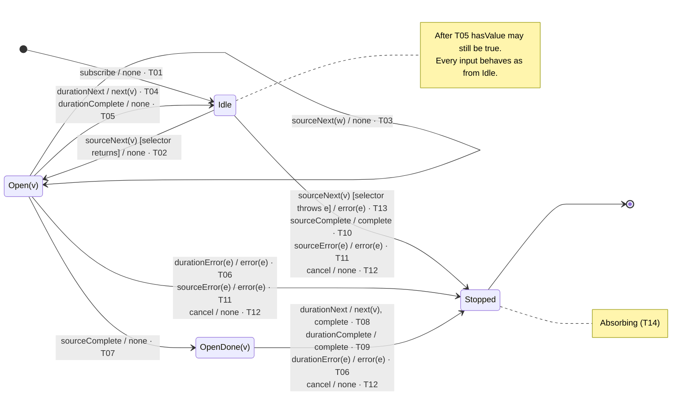

# audit — state transition diagram and table

Derived from [operators/audit.md](../operators/audit.md), sections B and C.
Pin: RxJS **7.8.2**, commit `e5351d02e225e275ac0e497c7b66eaa5f0c88791`,
`src/internal/operators/audit.ts`. Row IDs `T01`–`T16` and scenario IDs
`S01`–`S08` refer to that file. Nothing here was executed; the status of the
evidence is the same as there.

## Conventions

- Edge label: `input [guard] / output · row`. One edge per ordered state pair;
  transitions that share a pair are stacked on that edge, one per line. Output
  `none` means no downstream notification. Lifecycle effects (unsubscribe, flag
  writes) are in the table notes, not on the edge.
- `Open(v)` and `OpenDone(v)` carry the pending value `v`. `sourceNext(w)` in
  `Open(v)` goes to `Open(w)`; the selector is not called again.
- `Idle` after `T05` still has `hasValue = true` and `lastValue = v`. Section C
  writes it as `Idle with stale hasValue`. It is drawn as `Idle` here because
  every input in Σ behaves the same from both: `sourceNext` overwrites both
  fields (`audit.ts` 81–82), `sourceComplete` passes the guard at line 91
  through `!durationSubscriber`, and `sourceError` / `cancel` do not read them.
- `Stopped` is absorbing (`T14`).

## State legend

| State | `durationSubscriber` | `hasValue` / `lastValue` | `isComplete` | Lines |
| --- | --- | --- | --- | --- |
| `Idle` | `null` | `false`, or stale `true` / `v` after `T05` | `false` | 55–58, 62, 73 |
| `Open(v)` | live | `true` / `v` | `false` | 81–86 |
| `OpenDone(v)` | live | `true` / `v` | `true` | 89–91 |
| `Stopped` | — | — | — | terminal |

## State transition diagram

## State transition table

δ and λ in one cell: `next state / output · row`. Output order inside a cell is
delivery order. `—` means the pair cannot occur in that state (section C:
`inapplicable`). `†` marks a cell that section C does not list as its own row.

| State × Input | `sourceNext(w)` | `sourceComplete` | `sourceError(e)` | `cancel` | `durationNext` | `durationComplete` | `durationError(e)` |
| --- | --- | --- | --- | --- | --- | --- | --- |
| `Idle` | selector returns: `Open(w)` / `none` · T02 selector throws `e`: `Stopped` / `error(e)` · T13 | `Stopped` / `complete` · T10 | `Stopped` / `error(e)` · T11 | `Stopped` / `none` · T12 | — · T15 | — | — |
| `Open(v)` | `Open(w)` / `none` · T03 | `OpenDone(v)` / `none` · T07 | `Stopped` / `error(e)` · T11 | `Stopped` / `none` · T12 | `Idle` / `next(v)` · T04 | `Idle` / `none` · T05 | `Stopped` / `error(e)` · T06 |
| `OpenDone(v)` | — · T16 | — | — | `Stopped` / `none` · T12 | `Stopped` / `next(v)`, `complete` · T08 | `Stopped` / `complete` · T09 | `Stopped` / `error(e)` · T06† |
| `Stopped` | — · T14 | — · T14 | — · T14 | — · T14 | — · T14 | — · T14 | — · T14 |

### Cell notes

- **`Idle` × `sourceNext`.** `hasValue` and `lastValue` are written before the
  selector runs (`audit.ts` 81–82). When the selector or `innerFrom` throws,
  the write is unobservable because the output errors (T13). The duration is
  subscribed with `endDuration` as `next` handler and `cleanupDuration` as
  `complete` handler (84–86).
- **`Idle` × `sourceComplete`.** The guard at line 91 is always true here
  because `durationSubscriber` is `null`, so a stale `hasValue` after T05 is
  not flushed (S03, S06).
- **`Open(v)` × `sourceComplete`.** `isComplete = true`; the guard fails because
  `hasValue` is true and the duration is live. `durationSubscriber.closed` is
  false in every reachable `Open`: `endDuration` and `cleanupDuration` both
  null the field, and duration error or `cancel` lead to `Stopped`. The
  `closed` check is defensive.
- **`Open(v)` × `durationNext`.** `endDuration` unsubscribes the duration,
  nulls the slot, clears `hasValue` and `lastValue`, then emits (60–68).
  `isComplete` is false, so no `complete` (69).
- **`Open(v)` × `durationComplete`.** `cleanupDuration` nulls the slot only
  (72–74). `hasValue` and `lastValue` are left as they were. See the
  convention above for why this is still `Idle`.
- **`OpenDone(v)` × `durationNext`.** Same `endDuration`; `isComplete` is true,
  so `complete` follows `next(v)` (S05).
- **`OpenDone(v)` × `durationComplete`.** `complete` only; `v` is dropped (S03).
- **`OpenDone(v)` × `durationError(e)` †.** Section C row T06 names `Open(v)`
  only. The duration subscriber has no `error` handler, so `OperatorSubscriber`
  forwards to the destination in both states. The cell is filled from that
  handler, not from a C row.
- **`OpenDone(v)` × source inputs.** The source has already completed, so
  `sourceNext`, `sourceComplete`, and `sourceError` cannot arrive (T16).
- **`Idle` × duration inputs.** No duration is live (T15). A duration that
  `next`s or completes synchronously inside the `subscribe` at line 84 is
  modeled as `T02` immediately followed by `T04` or `T05`.
- **`cancel`.** The duration subscriber is a child of the destination, so
  unsubscribing the output unsubscribes it without running `endDuration` or
  `cleanupDuration`. No `next`, no `complete` (S07).

## Coverage of the table against section C

| Rows | Where they appear |
| --- | --- |
| T01 | initial edge |
| T02, T03, T04, T05, T06, T07, T08, T09, T10, T11, T12, T13 | one cell each; T06, T11, T12 appear in more than one cell |
| T14, T15, T16 | `—` cells |
| none | `OpenDone(v)` × `durationError(e)` is the only filled cell without its own C row (†) |
