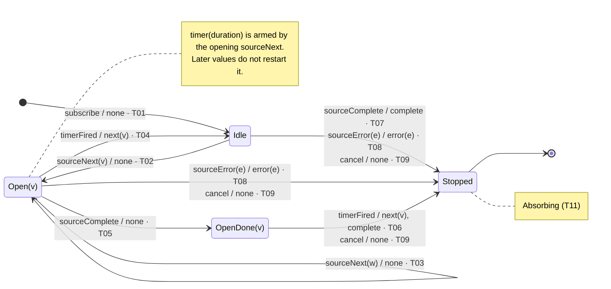

# auditTime — state transition diagram and table

Derived from [operators/auditTime.md](../operators/auditTime.md), sections B
and C. Pin: RxJS **7.8.2**, commit `e5351d02e225e275ac0e497c7b66eaa5f0c88791`,
`src/internal/operators/auditTime.ts` delegating to `audit.ts` and `timer.ts`.
Row IDs `T01`–`T13` and scenario IDs `S01`–`S06` refer to that file. Nothing
here was executed; the status of the evidence is the same as there.

`auditTime(duration, scheduler)` is `audit(() => timer(duration, scheduler))`
(`auditTime.ts` 54). The control states are `audit`'s. The duration alphabet is
specialized: `timer` always emits `next(0)` and then completes, so the only
duration input that reaches the machine is `timerFired`. Compare
[diagrams/audit.md](audit.md) for the general machine.

## Conventions

- Edge label: `input [guard] / output · row`. One edge per ordered state pair;
  transitions that share a pair are stacked on that edge, one per line. Output
  `none` means no downstream notification. Lifecycle effects (arming or
  disposing the timer, flag writes) are in the table notes, not on the edge.
- `Open(v)` and `OpenDone(v)` carry the pending value `v`. `sourceNext(w)` in
  `Open(v)` goes to `Open(w)`; the timer is not restarted.
- There is no stale-`hasValue` `Idle` here. `audit` reaches it through a
  duration that completes without `next`; `timer` never does that
  (`timer.ts` 173–181), so `Idle` always has `hasValue = false`.
- `Stopped` is absorbing (`T11`).

## State legend

| State | `durationSubscriber` | `hasValue` / `lastValue` | `isComplete` | Lines |
| --- | --- | --- | --- | --- |
| `Idle` | `null` | `false` | `false` | `audit.ts` 55–58, 62 |
| `Open(v)` | timer armed at the opening `sourceNext` | `true` / `v` | `false` | `audit.ts` 81–86, `auditTime.ts` 54 |
| `OpenDone(v)` | timer armed | `true` / `v` | `true` | `audit.ts` 89–91 |
| `Stopped` | — | — | — | terminal |

## State transition diagram

Standalone source: [auditTime.mmd](auditTime.mmd), identical to the block below. GitHub
renders `.mmd` files and leaves their Code and Blame tabs empty; use the Raw
button there to see the text.

## State transition table

δ and λ in one cell: `next state / output · row`. Output order inside a cell is
delivery order. `—` means the pair cannot occur in that state (section C:
`inapplicable`). `†` marks a cell that section C does not list as its own row.

| State × Input | `sourceNext(w)` | `sourceComplete` | `sourceError(e)` | `cancel` | `timerFired` | `timerComplete` |
| --- | --- | --- | --- | --- | --- | --- |
| `Idle` | `Open(w)` / `none` · T02 | `Stopped` / `complete` · T07 | `Stopped` / `error(e)` · T08 | `Stopped` / `none` · T09 | — · T12 | — |
| `Open(v)` | `Open(w)` / `none` · T03 | `OpenDone(v)` / `none` · T05 | `Stopped` / `error(e)` · T08 | `Stopped` / `none` · T09 | `Idle` / `next(v)` · T04 | — not delivered · T10 |
| `OpenDone(v)` | — | — | — | `Stopped` / `none` · T09† | `Stopped` / `next(v)`, `complete` · T06 | — not delivered · T10 |
| `Stopped` | — · T11 | — · T11 | — · T11 | — · T11 | — · T11 | — · T11 |

### Cell notes

- **`Idle` × `sourceNext`.** `hasValue` and `lastValue` are written first
  (`audit.ts` 81–82). The selector `() => timer(duration, scheduler)` ignores
  `v` (`auditTime.ts` 54, I07) and returns a fresh cold `timer` per window; it
  is not one shared clock. `duration < 0` is clamped to `0` inside `timer`
  (`timer.ts` 161–163, T13); the firing is still a scheduled action, so the
  transition is T04 later, not an emission inside `sourceNext`.
- **`Open(v)` × `sourceNext(w)`.** `lastValue = w`; the timer is not restarted
  (`audit.ts` 83). The window is measured from the opening value (I01).
- **`Open(v)` × `timerFired`.** `timer`'s `next(0)` runs `endDuration`, which
  unsubscribes the timer (`audit.ts` 61) before `next(v)` (67). `isComplete`
  is false, so no `complete` (69).
- **`Open(v)` × `sourceComplete`.** `isComplete = true`; the guard at line 91
  fails because `hasValue` is true and the timer is live, so the output waits
  (S03).
- **`OpenDone(v)` × `timerFired`.** Same `endDuration`; `isComplete` is true,
  so `complete` follows `next(v)` (S03).
- **`OpenDone(v)` × `cancel` †.** Section C row T09 names `Open` and `Idle`
  only. The output subscription stays alive in `OpenDone` until the timer
  fires, so `cancel` can arrive there. Same mechanism as T09: the timer action
  is a child of the destination and is disposed; no `next`, no `complete`.
- **`OpenDone(v)` × source inputs.** The source has already completed, so no
  further source input can arrive.
- **`timerComplete` column.** `timer` emits `0` and then completes
  (`timer.ts` 173–181). The `next` reaches `endDuration` first, which
  unsubscribes the duration subscriber, so the following `complete` is never
  delivered and `cleanupDuration` does not run. `audit`'s drop-on-silent-
  complete path is therefore unreachable here (T10, I03). This is also why the
  stale-`hasValue` `Idle` of the `audit` diagram does not exist in this one.
- **`Idle` × `timerFired`.** No timer is armed (T12). Every timer is
  unsubscribed inside `endDuration`, so a late firing cannot occur in the
  ordinary model.
- **`cancel`.** The timer action is disposed with the destination without
  running `endDuration`; advancing time afterwards must not emit (S06).
- **Same-instant ties.** A `sourceNext` in the same virtual instant as
  `timerFired` is ordered by scheduler queue order (section A assumption). The
  table assumes each input runs to quiescence before the next.

## Coverage of the table against section C

| Rows | Where they appear |
| --- | --- |
| T01 | initial edge |
| T02, T03, T04, T05, T06, T07, T08, T09 | one cell each; T08 and T09 appear in more than one cell |
| T10, T11, T12 | `—` cells |
| T13 | parameter-domain row; resolves to T04 after `timer` clamps `duration < 0` to `0` (cell note) |
| none | `OpenDone(v)` × `cancel` is the only filled cell without its own C row (†) |
