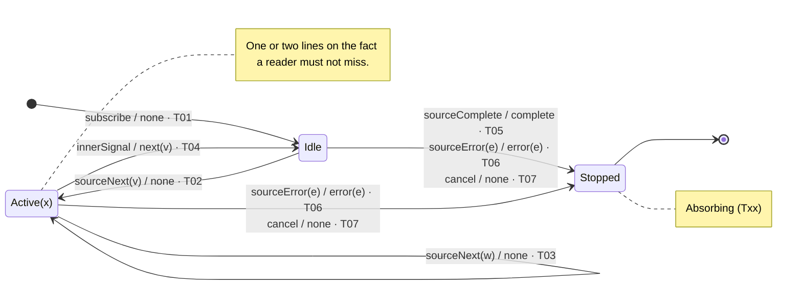

# [operator] — state transition diagram and table

Derived from [operators/[operator].md](../operators/[operator].md), sections B
and C. Pin: RxJS **7.8.2**, commit `e5351d02e225e275ac0e497c7b66eaa5f0c88791`,
`src/internal/operators/[operator].ts`. Row IDs `T01`–`[Tnn]` and scenario IDs
`S01`–`[Snn]` refer to that file. Nothing here was executed; the status of the
evidence is the same as there.

[Optional paragraph: what is special about this machine. Delegation to another
operator, a specialized alphabet, a shared helper. Link the related diagram
file when one exists.]

## Conventions

- Edge label: `input [guard] / output · row`. One edge per ordered state pair;
  transitions that share a pair are stacked on that edge, one per line. Output
  `none` means no downstream notification. Lifecycle effects ([the effects this
  operator has: inner subscribe/unsubscribe, timer arming, flag writes]) are in
  the table notes, not on the edge.
- [Which states carry data, what the parameter means, and how a repeated input
  updates it. Example: `Open(v)` carries the pending value `v`; `sourceNext(w)`
  in `Open(v)` goes to `Open(w)`.]
- [Any state merged or split relative to section B, with the input-by-input
  argument why the merge preserves behavior. Delete this bullet if none.]
- `Stopped` is absorbing (`[row]`).

## State legend

| State | [field 1] | [field 2] | [field 3] | Lines |
| --- | --- | --- | --- | --- |
| `Idle` | [value] | [value] | [value] | [source lines] |
| `[State(x)]` | [value] | [value] | [value] | [source lines] |
| `Stopped` | — | — | — | terminal |

## State transition diagram

Standalone source: [[operator].mmd]([operator].mmd), identical to the block below. GitHub
renders `.mmd` files and leaves their Code and Blame tabs empty; use the Raw
button there to see the text.

## State transition table

δ and λ in one cell: `next state / output · row`. Output order inside a cell is
delivery order. `—` means the pair cannot occur in that state (section C:
`inapplicable`). `†` marks a cell that section C does not list as its own row.

| State × Input | `sourceNext(w)` | `sourceComplete` | `sourceError(e)` | `cancel` | [`innerSignal` / `timerFired` / other Σ inputs, one column each] |
| --- | --- | --- | --- | --- | --- |
| `Idle` | [next / output · row] | [next / output · row] | [next / output · row] | [next / output · row] | [— · row] |
| `[State(x)]` | [next / output · row] | [next / output · row] | [next / output · row] | [next / output · row] | [next / output · row] |
| `Stopped` | — · [row] | — · [row] | — · [row] | — · [row] | — · [row] |

### Cell notes

- **`[State]` × `[input]`.** [Statement order in the handler with line numbers,
  the guard, why it passes or fails here.]
- **`[State]` × `[input]` †.** [Closest C row, why the pair is reachable
  anyway, and which handler fills the cell.]
- **`[State]` × [inapplicable inputs].** [Why the pair cannot occur.]
- **`cancel`.** [What is disposed with the destination and which handlers do
  not run.]
- **[Same-instant ties, if a scheduler is involved.]** [Ordering assumption
  from section A.]

## Coverage of the table against section C

| Rows | Where they appear |
| --- | --- |
| T01 | initial edge |
| [T02 … Tnn] | one cell each; [rows that appear in more than one cell] |
| [rows C marks inapplicable] | `—` cells |
| [rows that are not transitions, e.g. parameter-domain rows] | [where they are explained] |
| none | [the `†` cells, or "no filled cell without its own C row"] |
